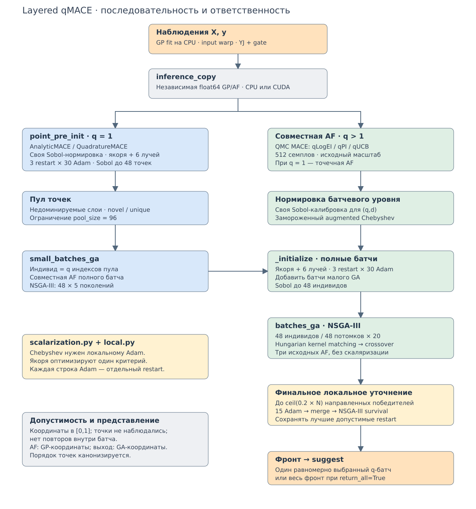

# Как устроен layered-поиск

Точка входа — `LayeredSearch.search` в `tidyhebo/layered/search.py`.
Объект реализует общий интерфейс `CandidateSearch`; отдельного объекта `Stage`
и обёрток над выбранными критериями нет. Во всём поиске фиксирована тройка AF.

Редактируемая схема: [layered-search.drawio](diagrams/layered-search.drawio).
Её обзор добавлен также отдельной страницей в `project-structure.drawio`.

## Порядок вычислений

1. **Подготовка модели.** `inference_copy` создаёт независимую float64-копию
   GP/AF на заданном CPU/CUDA. Fitting-модель остаётся на CPU. Параметры копии
   заморожены, но производные AF по координатам кандидатов доступны.
2. **`point_pre_init`.** Для q = 1 создаётся `AnalyticMACE`, если после gate
   исходный масштаб гауссовский; при активном YJ создаётся `QuadratureMACE`.
   Сначала замораживается Sobol-нормировка точечного уровня. Три якоря и шесть
   направлений уточняются Adam с тремя restart на цель. Sobol дополняет
   популяцию до 48. Эволюционного поиска одиночных точек нет.
3. **Пул точек.** Кандидаты очищаются от наблюдённых и повторных точек,
   сортируются по недоминируемым слоям и сохраняются до ограничения pool_size.
   Это реальные точки (n_pool, 1, d), а не целые батчи.
4. **`small_batches_ga`.** Индивид — q индексов пула. Малый NSGA-III с
   популяцией 48 и пятью поколениями подбирает полные батчи по совместной AF.
   Повторные индексы и совпадающие точки запрещены. Если пул меньше q, он
   расширяется Sobol-точками.
5. **Подготовка батчей.** Нормировка пересчитывается один раз для батчевого
   уровня. `_initialize` уточняет совместные якоря и направления в пространстве
   (q,d), добавляет батчи малого GA и дополняет Sobol до 48 индивидов.
6. **`batches_ga`.** NSGA-III эволюционирует полные неупорядоченные q-наборы:
   48 индивидов, 48 потомков и 20 поколений. Перед кроссовером Hungarian
   сопоставляет точки родителей по kernel-distance с учётом input warp/ARD.
   GA видит три исходных критерия; Chebyshev нужен локальному уточнению.
7. **Финальное уточнение.** При memetic='end' выбираются направленные победители,
   не более ceil(0.2*N); Adam делает 15 шагов. Допустимые улучшения объединяются
   с популяцией, затем применяется обычный survival NSGA-III.
8. **Результат.** Остаётся допустимый недоминируемый фронт полных батчей.
   `suggest` равномерно выбирает один батч либо возвращает весь фронт при
   return_all=True. Межбатчевые повторения точек разрешены; внутрибатчевые нет.

При q = 1 обе ступени используют точечную AF; возвращаемый фронт имеет форму
(k,d). При q > 1 — (k,q,d). На вход AF подаются GP-координаты, на выход общего
интерфейса поиска — GA-координаты.

## Ответственность модулей

| Модуль | Ответственность |
|---|---|
| `acquisition.py` | AnalyticMACE, QuadratureMACE, QMC MACE и повторное использование семплов |
| `layered/search.py` | Порядок ступеней, инициализация, пулы и два GA |
| `layered/local.py` | Численные функции projected Adam и отбора restart |
| `layered/scalarization.py` | Замороженный масштаб и augmented Chebyshev |
| `layered/inference.py` | Копирование GP/AF и размещение на CPU/CUDA |
| `qmace/ga_components.py` | Сопоставление родителей, mating и set-deduplication |

`_prepare_level` меняет текущую AF, размер q, бюджет и замороженную нормировку
внутри одного `LayeredSearch`. Между вызовами `suggest` оптимизатор не переносит
популяции. `search_state` удалён: прежде это был только словарь измерений
speed probe, а не состояние, необходимое алгоритму. Тесты бюджетов наблюдают
вызовы evaluator напрямую.

## Явный выбор AF вместо evaluation='auto'

`evaluation` принимает `analytic`, `quadrature`, `qmc`. При пропуске параметра
семейства MACE/qMACE фиксированно используют qmc, EI/LogEI — analytic.
Конфигурация не выбирает реализацию на основании результата обучения.

**Изменение прежнего поведения:** обычный, не layered MACE с q=1 и активным YJ
теперь не переключается на квадратуру автоматически. Для сохранения этого
режима нужно передать `AcquisitionConfig(evaluation='quadrature')`.
Аналитический MACE требует q=1 и отсутствия активного нелинейного outcome warp.
Квадратура требует q=1 и активного YJ; qMACE требует qmc.

В `point_pre_init` выбор между аналитикой и квадратурой явно записан одной
веткой, потому что точечная подготовка — фиксированная часть layered-метода.
Отдельного режима auto и вспомогательной фабрики point_acquisition нет.
`inference_device='auto'` сохранён: это независимый выбор устройства.

## Измерение скорости

CPU/CUDA speed probe относится к репозиторию экспериментов. В библиотеке нет
скрипта запуска этого эксперимента, сборщика времён и словаря диагностики.
CUDA-реализация, проверка наличия устройства и тесты значений/градиентов сохранены.
